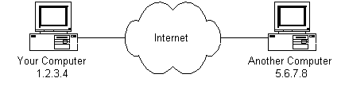
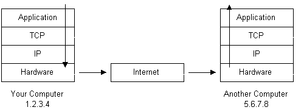
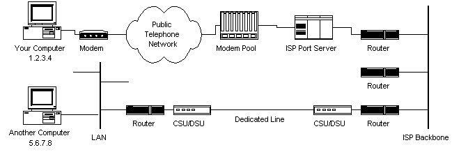
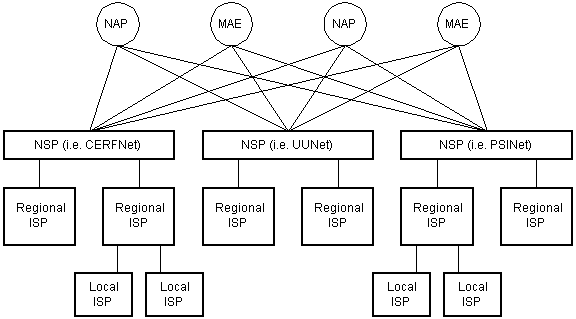
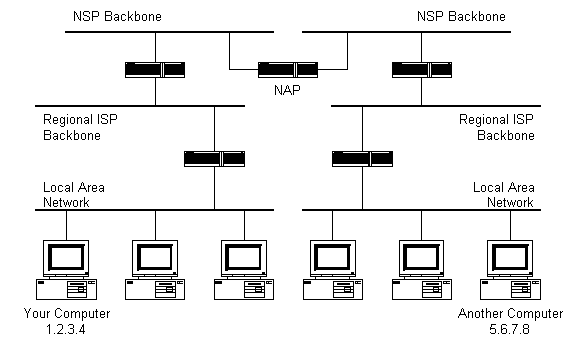
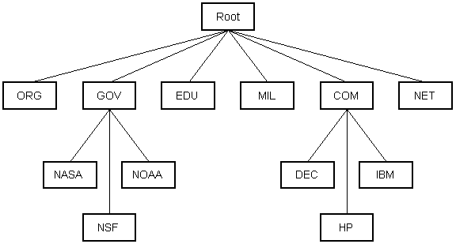
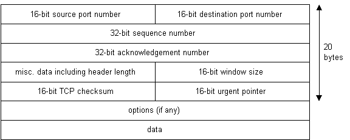
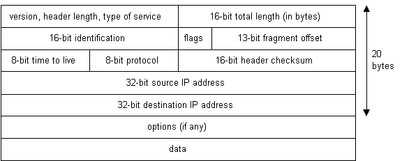
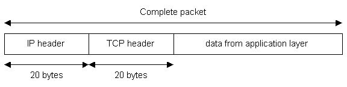

在浏览器中输入一个网址，为什么就能看到远方服务器上的网页？一段文字又是怎样穿过网络，到达另一台计算机的？理解这些问题，可以从 IP 地址、协议栈、路由器和 DNS 开始。

本文根据 Rus Shuler 的 **How Does the Internet Work?** 翻译整理，沿着原文从基础设施到应用协议的顺序，说明互联网各部分怎样协同工作。

> **原文与译注说明**：原文署名 Rus Shuler，写于 1998 年，2002 年更新，页面标注 © 2002 Rus Shuler / Pomeroy IT Solutions，保留所有权利。英文正文和九张示意图的权利归原权利人所有。本文以用户提供的本地 HTML 为翻译依据；该文件记录的来源是 [斯坦福课程存档](https://web.stanford.edu/class/msande91si/www-spr04/readings/week1/InternetWhitepaper.htm)。为适合博客阅读，调整了段落、表格和小标题；对历史操作与技术问题的补充均标为“译注”，文末资源区保留原文书目并另列核对资料。

<!-- more -->

## 一、引言

互联网究竟是怎样工作的？这是一个好问题。随着互联网迅速发展，电视、广播和杂志中到处都能见到各种网址。互联网已经成为生活的重要组成部分；要更有效地使用它，我们需要理解它的基本原理。

这篇文章介绍支撑互联网运转的底层基础设施与技术。它不会深入每个细节，但会覆盖各个领域的核心概念，帮助读者建立基本认识。文末还列出了进一步学习的资源。

## 二、从哪里开始？IP 地址

互联网是一个全球性的计算机网络。要在网络中通信，计算机需要能够被寻址。

原文从 IPv4 地址讲起。这类地址通常写成：

```text
nnn.nnn.nnn.nnn
```

其中每个 `nnn` 都是 0～255 之间的整数。这个地址叫作 **IP 地址**，IP 是 Internet Protocol，即“互联网协议”的缩写。

下图展示了连接到互联网的两台计算机：一台地址为 `1.2.3.4`，另一台为 `5.6.7.8`。图中间先把互联网当作一个整体，后面会逐步展开其中的细节。



在原文的拨号上网场景中，互联网服务提供商 ISP（Internet Service Provider）通常会在拨号连接期间分配一个临时 IP 地址。如果计算机通过局域网 LAN（Local Area Network）接入，则可能使用固定地址，也可能从 DHCP（动态主机配置协议）服务器获取临时地址。

> **译注：IP 地址的唯一性有范围。** 原文把这一点概括为“每台上网计算机都有唯一 IP 地址”。在实际网络中，私有地址可以在不同局域网中重复使用，多台设备也可以通过 NAT/NAPT 共享一个公网 IPv4 地址；一台设备还可能拥有多个地址。相关机制见 [RFC 3022](https://www.rfc-editor.org/rfc/rfc3022.html)。此外，上面的点分十进制形式描述的是 IPv4，IPv6 使用另一种地址格式。

### 动手观察：ping

Windows 和许多 Unix 类系统都提供 `ping` 工具，可以用它观察目标是否回应 ICMP 回显请求，以及往返所需时间。

原文使用的命令是：

```shell
ping www.yahoo.com
```

如果输入的是域名，工具通常会先解析域名，再显示使用的 IP 地址。随后，它发送 ICMP（互联网控制消息协议）Echo Request，并等待 Echo Reply。

> **译注**：这是一条操作示例，本文未执行该命令。目标主机或中间网络可能过滤 ICMP；没有收到回复，不能单凭这一点判断主机离线或网站不可访问。Windows 的 `ping` 通常发送有限次请求，部分 Unix 类系统默认持续运行，可用 `Ctrl+C` 结束。

## 三、协议栈与数据包

假设你的计算机地址为 `1.2.3.4`，想向 `5.6.7.8` 发送一句话：

```text
Hello computer 5.6.7.8!
```

这段文字必须变成适合传输介质的信号，经过网络后，再在另一端恢复为文字。完成这一过程，需要 **协议栈（protocol stack）**。

协议栈通常由操作系统及相关网络软件实现。互联网使用的协议族常称为 TCP/IP，因为 TCP 和 IP 是其中两个重要协议。原文使用下面的简化分层：

| 层次    | 作用                                   |
| ----- | ------------------------------------ |
| 应用协议层 | 定义网页、电子邮件、FTP 等应用怎样交换信息              |
| TCP 层 | 通过端口区分应用，并提供可靠传输                     |
| IP 层  | 根据 IP 地址将数据包送向目标网络与主机                |
| 硬件层   | 把二进制数据转换为网络信号，并在接收时转换回来，例如网卡或拨号调制解调器 |

> **译注**：这是便于入门的教学模型。传输层还包括 UDP；原文“硬件层”合并了链路与物理传输的许多细节，不能理解为互联网只包含表中的四个具体协议。



沿着这条消息的传输路径，可以把过程理解为：

1. 消息从发送端协议栈的顶部进入，逐层向下传递。
2. 较长的数据会被处理成适合网络传输的小块。原文统称这些小块为数据包（packet）。
3. 经过 TCP 层时，数据被组织为 TCP 报文段，并附加包含端口号等信息的 TCP 首部。端口帮助接收端把数据交给相应应用。
4. 经过 IP 层时，再附加 IP 首部，其中包含目的地址 `5.6.7.8`。
5. 网络接口将封装后的数据转换为信号，送入传输介质。原文举的是通过电话线拨号上网的例子。
6. ISP 的路由器检查目的地址，决定下一步将数据包转发到哪里；下一站通常还是另一台路由器。
7. 数据包最终到达目标计算机，从协议栈底部开始向上处理。
8. 各层读取并移除对应的封装信息，完成必要的校验与数据重组。
9. 接收应用最终读到原来的消息：`Hello computer 5.6.7.8!`。

这里最重要的概念是 **封装与解封装**：发送端逐层添加控制信息，接收端逐层解释这些信息，恢复应用数据。

> **译注**：并非每一层都会拆分数据，也不是所有首部信息都属于“路由信息”。TCP 的端口号主要用于端点上的应用分用，路由器转发 IP 数据包主要依据 IP 层信息。

## 四、接入网络：计算机与 ISP 之间有什么

现在我们知道了数据如何通过协议栈，但两台计算机之间究竟有哪些设备？



在原文的拨号接入环境中，ISP 会维护一组调制解调器，为拨号用户提供连接。某种管理计算机或专用设备负责控制调制解调器池与骨干网、专线路由器之间的数据流。这类设备有时被称为端口服务器，因为它提供网络接入服务；计费与使用情况也可能在这里汇总。

数据包穿过电话网络和 ISP 的本地设备后，会被路由到 ISP 自己的骨干网，或者 ISP 购买带宽接入的上游骨干网。随后，数据包可能跨越多个路由器、骨干网、专线和其他网络，直到到达目的地。

> **译注**：电话线、调制解调器池和拨号服务器是原文的时代背景。阅读时可以保留“用户设备 → 接入网络 → 运营商网络 → 其他网络 → 目标设备”这条主线，具体接入设备会随网络技术而变化。

### 动手观察：traceroute 与 tracert

如果想观察通往某个目标的路径，可以使用路径探测工具。

在 Windows 命令提示符或 PowerShell 中：

```powershell
tracert www.yahoo.com
```

在已安装 `traceroute` 的 Unix 类系统终端中：

```shell
traceroute www.yahoo.com
```

也可以把域名替换为 IP 地址。原文指出，输出中可能出现较长的路由器名称，例如：

```text
sjc2-core1-h2-0-0.atlas.digex.net
fddi0-0.br4.SJC.globalcenter.net
```

这些是原文中的历史名称示例，并非本文的探测输出。图 3 只展示了少量路由器，真实互联网要复杂得多。

> **译注**：这类工具通过逐步增加 IPv4 TTL 或 IPv6 Hop Limit 来探测路径，看到的是愿意响应探测的节点。星号可能表示超时或响应被过滤；负载均衡、路由变化和返回路径差异也会影响结果，因此输出不能保证完整呈现所有业务数据包的实际路径。

## 五、互联网基础设施：网络如何互联

互联网骨干由许多相互连接的大型网络组成。原文把这些网络的提供者称为 **NSP（Network Service Provider，网络服务提供商）**，并列举了 UUNet、CerfNet、IBM、BBN Planet、SprintNet、PSINet 等当时的例子。

这些网络通过互联交换数据包。原文介绍了几种历史上的互联设施：

| 名称 | 原文中的含义 |
| --- | --- |
| NAP（Network Access Point） | 网络接入点，不同骨干网在此交换流量 |
| MAE（Metropolitan Area Exchange） | 都会区交换设施，承担类似的网络互联作用，原文强调其私人运营背景 |
| IX（Internet Exchange Point） | 互联网交换点，对互联设施的统称，也常写作 IXP |

NSP 还会向规模较小的网络、ISP 和带宽提供商出售带宽。



图 4 只是说明网络可能怎样互联，并不对应真实互联网中的某一块。这里没有画出物理设备，因为仅仅画清一家大型网络的骨干设施，就已经相当复杂。

原文指出，一些 NSP 会在网站上发布自己的网络地图。但要绘制整个互联网的完整地图，几乎不可能：它规模巨大、结构复杂，而且不断变化。

> **译注**：上述企业名称与 NAP/MAE 描述应放在原文年代下理解。原文还写到“每个 NSP 必须连接三个 NAP”，本文仅保留为历史陈述，不将其作为今天互联网运营的普遍要求。图中的层级是教学示意，实际网络互联也不必严格组成一棵树。

## 六、互联网路由：数据包怎样找到目的地

数据包怎样穿过互联网？是不是每台计算机都知道其他所有计算机的位置？或者，数据包会广播给整个互联网的每一台计算机？

都不是。负责指引转发方向的关键信息，保存在路由器的 **路由表（routing table）** 中。

路由器是一种分组交换设备，通常连接不同网络。它根据目的 IP 地址和本地转发信息，选择下一跳。



按照原文的简化模型：

1. 数据包到达路由器。
2. 路由器检查 IP 首部中的目的地址。
3. 查找路由表，判断应该把数据包转发到哪个网络或下一跳。
4. 如果没有更具体的匹配，但存在默认路由，就沿默认路由继续转发。
5. 数据包经过其他网络与路由器，逐步接近目的网络，最后到达接收主机。

原文用“先向上到骨干，再向下进入小网络”的方式解释这一过程。理解它的关键是：**每台路由器只需决定当前这一跳的转发方向，无须事先为数据包安排整个端到端旅程。**

> **译注**：实际 IP 路由通常按最长前缀匹配选择路由，默认路由只是匹配范围最广的一种路由；并非每台路由器都有默认路由。如果没有可用路由，数据包可能被丢弃。路径也不必严格“先向上、再向下”。

## 七、域名与地址解析：DNS 做了什么

如果不知道服务器的 IP 地址，只知道 `www.anothercomputer.com` 这样的名字，浏览器怎样找到它？

答案是 **DNS**。原文称其为 Domain Name Service；更常见的完整名称是 **Domain Name System，域名系统**。

DNS 是一个分布式、分层的命名系统。域名与 IP 地址之间的对应关系，是它提供的信息之一。

许多计算机分别保存 DNS 数据的一部分，并运行允许其他计算机查询的服务，这些就是 DNS 服务器。没有必要让一台服务器保存所有域名的完整资料；各服务器通过分工与委派，共同完成查询。



原文把 DNS 查询描述为沿层级寻找能够解析目标域名的服务器。建立网络连接时，系统通常会配置可使用的 DNS 服务器。用户输入网址后，应用先取得目标域名对应的 IP 地址，再连接目标服务器请求页面。

> **译注**：域名层级与 IP 路由层级是两回事。常见查询流程是：终端向递归解析器提问，解析器使用缓存，或按根服务器、顶级域服务器、权威服务器的委派关系继续查询。终端不一定亲自遍历所有层级，命中缓存时也不必从根开始。DNS 也不只保存地址记录。概念与递归、迭代查询机制见 [RFC 1034](https://www.rfc-editor.org/rfc/rfc1034.html)。

### 原文实验：在 Windows 中禁用 DNS

原文用 Windows 95/NT 的设置界面说明 DNS 的作用：

- 拨号用户可在“拨号网络”中打开连接属性，再进入 TCP/IP 设置。
- 固定连接用户可在“网上邻居”的属性中进入 TCP/IP 属性与 DNS 配置。
- 记下原 DNS 地址后，禁用 DNS 或将服务器地址改为 `0.0.0.0`；当时的系统可能需要重启。
- 再用浏览器访问域名，观察无法解析域名的现象；原文随后建议尝试直接输入预先查到的 IP 地址。

> **译注**：这里保留的是历史实验的译述，界面不适用于今天的 Windows，阅读本文无须修改网络配置。直接输入 IP 也不保证能访问相同网站：虚拟主机、HTTPS 证书、服务器名称选择等都可能依赖域名。DNS 缓存和应用自身的解析机制也可能影响实验现象。

## 八、重新认识互联网协议

前面已经提到，互联网的运行需要许多协议协作，包括 TCP、IP、路由协议、介质访问控制协议，以及各种应用层协议。

下面沿原文的顺序，从上层应用协议开始，再看更底层的 TCP 与 IP。

## 九、应用层协议：HTTP 与万维网

万维网 WWW（World Wide Web）是互联网的重要服务之一。浏览器与 Web 服务器之间交换请求和响应，使用的是 **HTTP（Hypertext Transfer Protocol，超文本传输协议）**。

不要把它和 HTML 混淆：

- **HTML** 是描述网页结构的标记语言。
- **HTTP** 是客户端与服务器交换网页及其他资源的应用层协议。

原文以基于文本的 HTTP 和早期短连接访问模型说明加载网页的过程：

1. 如果 URL 包含域名，先查询其 IP 地址。
2. 浏览器连接 Web 服务器，通过协议栈发送 HTTP 请求。
3. 服务器查找请求的页面；页面存在时返回内容，找不到对应资源时可能返回 `404 Not Found`。
4. 浏览器收到页面；在原文采用的短连接模型中，随后关闭连接。
5. 浏览器解析 HTML，发现还需要图片、Applet 等其他资源。
6. 对这些资源继续发起请求；原文模型为每个资源重新建立连接。
7. 所需资源加载并处理后，网页在窗口中呈现出来。

> **译注：无状态与无连接不能混为一谈。** 原文把 HTTP 称为“无连接协议”，并写到每次请求都必须新建连接，这不适合作为一般结论。HTTP 的无状态性描述请求语义；HTTP/1.1 默认使用持久连接，可以在同一连接上处理多个请求，见 [RFC 9112](https://www.rfc-editor.org/rfc/rfc9112.html)。HTTP/3 则映射在 QUIC 上，见 [RFC 9114](https://www.rfc-editor.org/rfc/rfc9114.html)。因此，也不能把“所有 HTTP 都直接运行在 TCP 上”作为通则。Applet 是原文时代的网页技术示例。

### 原文实验：用 Telnet 发送 HTTP 请求

原文通过 Telnet 客户端连接 `www.google.com` 的 80 端口，打开本地回显，然后输入以下请求，再连续按两次回车：

```http
GET / HTTP/1.0

```

这条请求的意思是：使用 HTTP/1.0 请求服务器根路径 `/`。原文描述，客户端随后会显示返回的网页源码，连接关闭后可通过日志查看内容。

> **译注**：这是原文的历史操作示例，本文未执行，也不保证该站点今天返回同样的结果。Telnet 这里只是用来建立明文 TCP 连接、观察 HTTP 文本；它不能直接完成 HTTPS 所需的 TLS 握手。空行用来结束请求首部。若使用 HTTP/1.1，请求通常还需要 `Host` 字段，不能只修改上面的版本号。

互联网中的很多协议由 **RFC（Request for Comments）** 文档定义。原文所用 HTTP/1.0 的历史规范是 [RFC 1945](https://www.rfc-editor.org/rfc/rfc1945.html)。

## 十、应用层协议：SMTP 与电子邮件

电子邮件也是常见的互联网服务。原文介绍的 **SMTP（Simple Mail Transfer Protocol，简单邮件传输协议）**，用于邮件传输。

SMTP 会话采用命令与响应的形式。服务器发送状态码，客户端根据响应继续提交发件人、收件人和邮件内容，最后结束会话。

> **译注：先区分发信与读信。** 原文把“打开客户端读取邮件”和 SMTP 命令交互放在同一段中，容易误导。SMTP 用于提交、传输与投递邮件，读取和同步邮箱通常由 IMAP、POP3 或其他接口完成。SMTP 的职责见 [RFC 5321](https://www.rfc-editor.org/rfc/rfc5321.html)。

按原文给出的 SMTP 交互模型：

1. 客户端连接邮件服务器，地址通常已在客户端中配置。
2. 服务器首先发送问候信息，标识自己。
3. 客户端发送 `HELO`，服务器成功接受后返回 `250`。
4. 客户端依次发送邮件事务命令，服务器逐条响应。
5. 客户端发送 `QUIT` 后，服务器回复并结束连接。

下面是原文从 RFC 821 引用的历史会话。`R:` 表示接收服务器发送的内容，`S:` 表示发送端发送的内容。发送者 Smith 位于 `USC-ISIF`，收件人 Jones、Green、Brown 位于 `BBN-UNIX`；其中 Green 没有对应邮箱。

```text
R: 220 BBN-UNIX.ARPA Simple Mail Transfer Service Ready
S: HELO USC-ISIF.ARPA
R: 250 BBN-UNIX.ARPA

S: MAIL FROM:<Smith@USC-ISIF.ARPA>
R: 250 OK

S: RCPT TO:<Jones@BBN-UNIX.ARPA>
R: 250 OK

S: RCPT TO:<Green@BBN-UNIX.ARPA>
R: 550 No such user here

S: RCPT TO:<Brown@BBN-UNIX.ARPA>
R: 250 OK

S: DATA
R: 354 Start mail input; end with <CRLF>.<CRLF>
S: Blah blah blah...
S: ...etc. etc. etc.
S: .
R: 250 OK

S: QUIT
R: 221 BBN-UNIX.ARPA Service closing transmission channel
```

这里的关键命令与状态码是：

| 内容 | 含义 |
| --- | --- |
| `HELO` | 客户端标识自身 |
| `MAIL FROM` | 指定信封发件人 |
| `RCPT TO` | 指定信封收件人，可出现多次 |
| `DATA` | 请求开始提交邮件数据 |
| `250` | 当前命令成功完成 |
| `550` | 本例中表示对应用户不存在 |
| `354` | 可以开始输入邮件数据 |
| 单独一行的 `.` | 结束邮件数据输入 |
| `QUIT` / `221` | 请求并确认结束会话 |

> **译注**：这段内容是协议教学示例，并非实际发送记录。它省略了完整邮件首部等内容；使用 SMTP 扩展时通常先用 `EHLO`。实际系统还可能涉及认证与传输加密，不能将这个简化会话直接当成完整的客户端配置流程。

## 十一、传输控制协议：TCP

在前面的协议栈中，应用层下面是 TCP 层。使用 TCP 的应用建立连接后，会把数据交给 TCP 处理。

原文首先强调端口的作用：一台计算机上可以同时运行浏览器、邮件客户端等多个程序，端口帮助操作系统把收到的数据交给正确的通信端点。

发送方向上的处理可以概括为：

1. TCP 接收应用提供的字节数据。
2. 将其组织成适合发送的报文段。
3. 为每个报文段附加 TCP 首部，其中包含源端口、目的端口、序号等信息。
4. 把报文段交给下层 IP。

接收方向则反过来：TCP 读取首部、进行校验与必要的数据重组，按序向相应应用提供字节流。

TCP 是一种 **面向连接、可靠的字节流服务**：

- **面向连接**：通信端在交换应用数据前先建立 TCP 连接。
- **可靠**：借助序号、确认和重传等机制，处理传输中的丢失与乱序等情况。
- **字节流**：应用读取的是连续字节序列，TCP 不保留应用每次写入的消息边界。



原文提醒读者：TCP 首部中没有专门存放源、目的 IP 地址的字段。端口信息在 TCP 首部中，IP 地址在 IP 首部中，体现了分层分工。

> **译注**：原文进一步写成“TCP 对 IP 地址一无所知”，这个表述过强。TCP 连接标识涉及本地与远端地址、端口，TCP 校验和也包含由 IP 层信息构成的伪首部。另外，TCP 不要求每个报文段都单独获得一次确认，确认可以累计、也可以延迟。相关定义见 [RFC 9293](https://www.rfc-editor.org/rfc/rfc9293.html)。可靠服务也不意味着网络永久故障时仍能保证交付。

### 原文列出的常见端口

| 服务 | 原文列出的端口 |
| --- | --- |
| FTP | 20 / 21 |
| Telnet | 23 |
| SMTP | 25 |
| HTTP | 80 |
| Quake III Arena | 27960 |

> **译注**：这是原文中的服务端口示例表。端口号本身还需要结合传输协议理解；FTP 的控制连接与数据连接有区别，不能把 20/21 理解为所有 FTP 模式下的固定通信方式。Quake III 的例子也不能据此归为 TCP 服务。服务实际监听端口可以另行配置。

## 十二、互联网协议：IP

与 TCP 相比，IP 提供的是 **无连接、尽力而为的数据报传输**。

这里的“尽力而为”意味着：IP 本身不保证数据包一定到达，也不保证按发送顺序到达，不负责通过确认和重传提供 TCP 那样的可靠字节流服务。

原文以 TCP/IP 为例：应用数据先由 TCP 处理，再交给 IP。IP 为数据添加 IP 首部，然后把数据包送入网络。不同数据包可以独立转发，最终可能乱序到达，或者根本没有到达；若上层使用 TCP，相关的有序可靠交付由 TCP 负责。



从图中可以看到发送方与接收方的 IP 地址。将应用层、TCP 和 IP 的封装放在一起，就得到下面的结构：



可以用文字表示为：

```text
IP 数据包
├── IP 首部：源 IP、目的 IP 等
└── TCP 报文段
    ├── TCP 首部：源端口、目的端口、序号等
    └── 应用数据
```

> **译注**：图 8 描述的是 IPv4 首部，IPv6 首部不同。图 9 采用 TCP 作为上层协议示例，IP 同样可以承载 UDP 等其他协议，并非所有 IP 数据包都包含 TCP 首部。实际在链路上传输时还会有相应的链路层封装。

## 十三、结语：从 IPv4 到 IPv6

原文最后提出一个问题：互联网还会一直保持这种样子吗？

IPv4 的地址字段为 32 位，理论地址空间共有 `2^32` 个地址，并非全部都可供普通公网主机使用。原文因此讨论了地址不足，以及当时研究机构和企业正在试验的 IPv6。

作者感慨，互联网从研究项目发展而来，已经走过很长的路。没有人能完全预见它会成为怎样的网络，但它正在以前所未有的方式连接世界，信息时代已经展开。

——Rus Shuler，1998 年撰写，2002 年更新。

> **译注**：原文“IPv6 正在研究骨干网上测试”的描述属于历史背景。IPv6 已有正式互联网标准规范，地址长度为 128 位，可参阅 [RFC 8200](https://www.rfc-editor.org/rfc/rfc8200.html)。阅读这篇文章时，应将长期有效的分层、寻址和路由概念，与特定年代的接入方式、企业名称及部署状态分开理解。

## 十四、资源与参考书目

### 原文资源导读

原文资源区列出了 IETF、InterNIC、Nexor 的 RFC 搜索页、Internet Weather、ClubNET Internet Weather，以及 Russ Haynal 的 ISP 页面，分别用于查阅协议、域名信息、延迟与丢包情况，以及骨干网地图。

其中部分地址具有明显的历史背景，本文未逐一验证其可用性。继续阅读时，可从 [IETF](https://www.ietf.org/) 和 [RFC Editor](https://www.rfc-editor.org/) 查阅协议资料。

### 原文参考书目

原文指出，以下两本书对写作帮助很大，并特别推崇 Stevens 的 TCP/IP 著作：

1. W. Richard Stevens，*TCP/IP Illustrated, Volume 1: The Protocols*，Addison-Wesley，1994。
2. Tom Sheldon，*Encyclopedia of Networking*，Osborne McGraw-Hill，1998。

原文还列出三本延伸阅读书籍，并说明写作时没有直接使用它们：

1. William R. Cheswick、Steven M. Bellovin，*Firewalls and Internet Security: Repelling the Wily Hacker*，Addison-Wesley，1994。
2. Fred Halsall，*Data Communications, Computer Networks and Open Systems*，第 4 版，Addison-Wesley，1996。
3. John D. Spragins、Joseph L. Hammond、Krzysztof Pawlikowski，*Telecommunications: Protocols and Design*，Addison-Wesley，1992。

### 译注核对资料

以下规范用于核对本文补充说明，不代表原文当年引用了这些后续文档：

- [RFC 3022：Traditional IP Network Address Translator](https://www.rfc-editor.org/rfc/rfc3022.html)：私有网络与地址、端口转换。
- [RFC 1034：Domain Names — Concepts and Facilities](https://www.rfc-editor.org/rfc/rfc1034.html)：DNS 的分层、委派及查询模型。
- [RFC 9112：HTTP/1.1](https://www.rfc-editor.org/rfc/rfc9112.html)：HTTP/1.1 报文与连接管理。
- [RFC 9114：HTTP/3](https://www.rfc-editor.org/rfc/rfc9114.html)：HTTP 在 QUIC 上的映射。
- [RFC 5321：Simple Mail Transfer Protocol](https://www.rfc-editor.org/rfc/rfc5321.html)：SMTP 邮件传输。
- [RFC 9293：Transmission Control Protocol](https://www.rfc-editor.org/rfc/rfc9293.html)：TCP 连接、可靠字节流与首部处理。
- [RFC 8200：Internet Protocol, Version 6 Specification](https://www.rfc-editor.org/rfc/rfc8200.html)：IPv6 基本规范。
